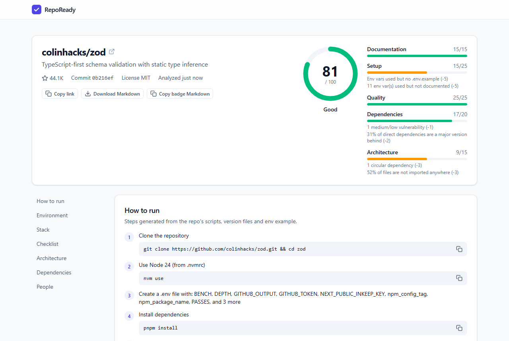
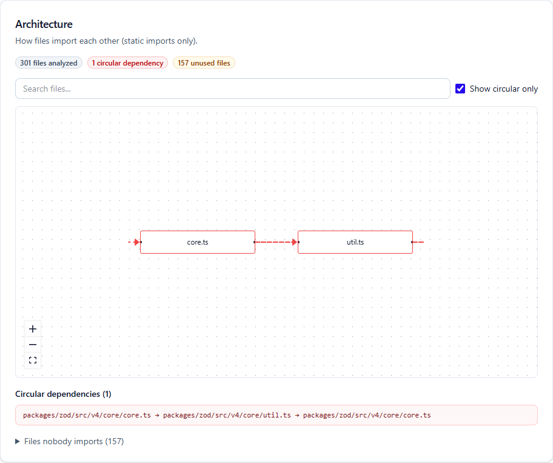
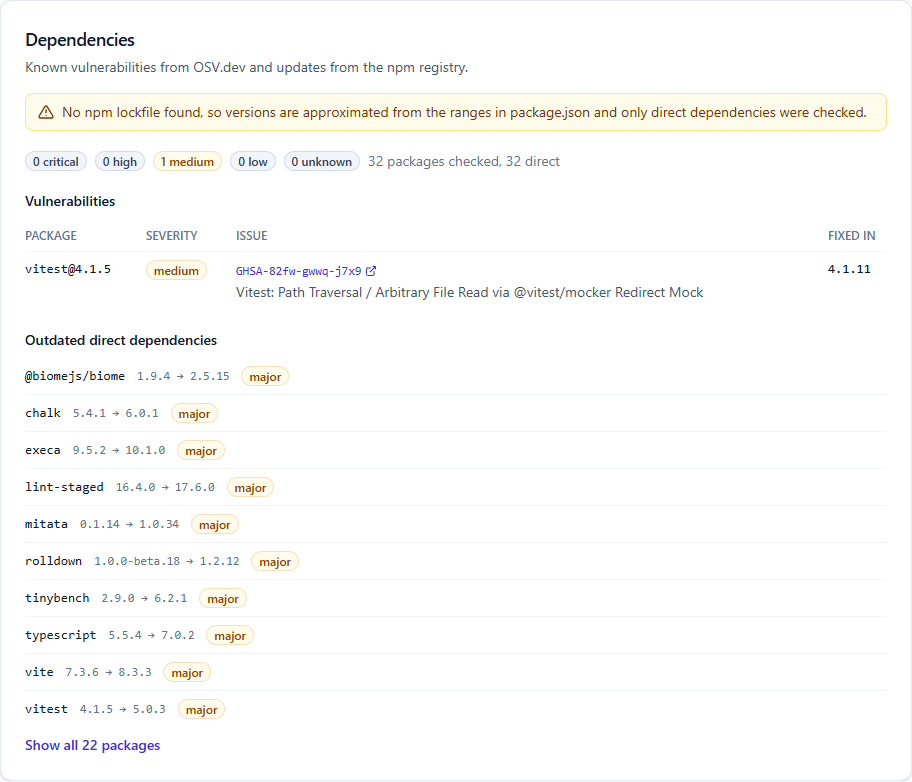
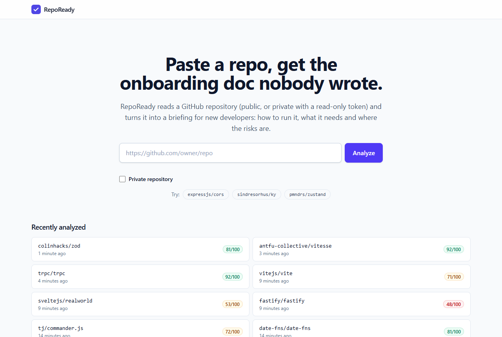
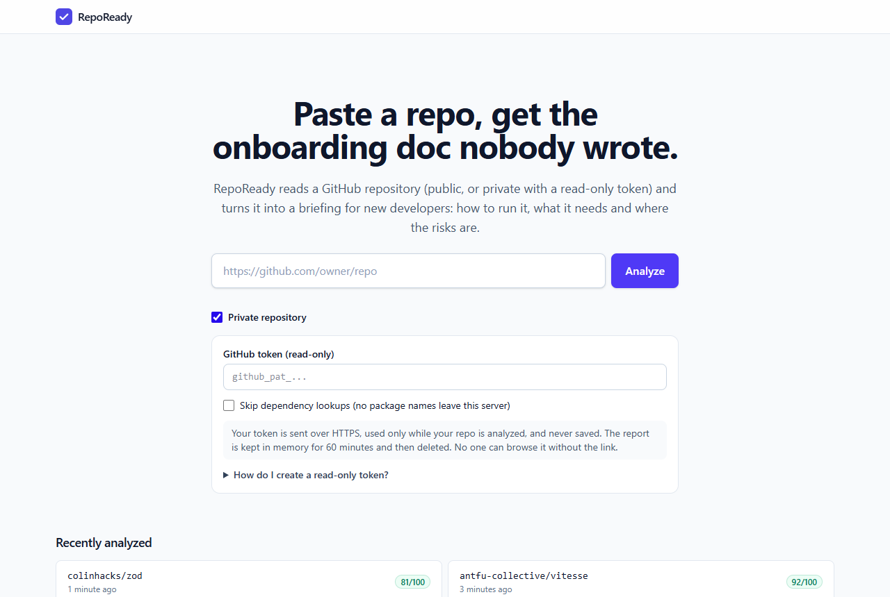
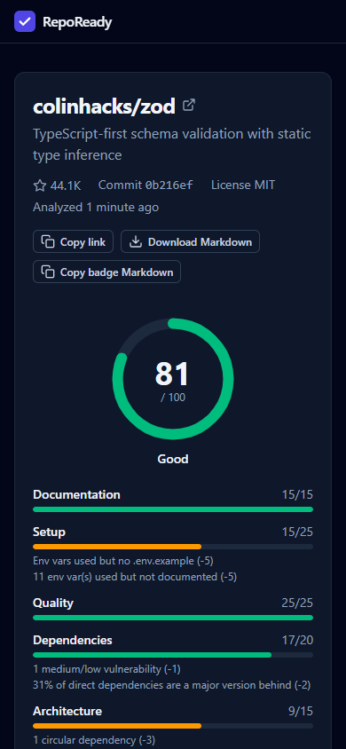

# RepoReady

> Paste a repo, get the onboarding doc nobody wrote.

**The problem.** New developers lose days to setup: missing `.env` values, unclear architecture,
stale or vulnerable dependencies, and nobody to ask. Tools exist for each slice, but as separate
CLIs. RepoReady puts all of it on one page.

**What it does.** Paste a GitHub repository URL and within about 10–30 seconds you get a briefing:
how to run it (commands ready to copy), which environment variables it needs, the stack, a health
checklist, an import graph with circular dependencies, known vulnerabilities and outdated
packages, who to ask about each folder, and a readiness score out of 100. Public repositories work
out of the box; private ones work with a read-only token you supply.

No AI runs inside the product: every result comes from deterministic parsing, static analysis and
public APIs (GitHub, OSV.dev, the npm registry). Analyzed code is only read, never executed.

**Demo:** _link added after deployment_ · **Status:** MVP complete; deployment next.



| Architecture graph with cycles                             | Dependency health                                          |
| ---------------------------------------------------------- | ---------------------------------------------------------- |
|  |  |

| Home and recent analyses           | Private repository mode                                 | Mobile, dark mode                                |
| ---------------------------------- | ------------------------------------------------------- | ------------------------------------------------ |
|  |  |  |

## How it works

```
browser ──POST /api/analyses──▶ Express API ──▶ GitHub (metadata, head commit)
   ▲                               │  cache hit? ──▶ existing report
   │ polls every 2 s               ▼
   │                         job queue (2 at a time, 90 s cap)
   │                               │ download tarball → temp dir (filtered, size-capped)
   │                               │ stack · how to run · env vars · checklist
   │                               │ architecture (madge in a worker thread) ┐
   │                               │ dependencies (OSV.dev + npm registry)    ├ in parallel
   │                               │ people (GitHub commits)                  ┘
   │                               │ score → MongoDB (public) or memory (private); temp dir deleted
   └──────── GET /api/analyses/:id ◀┘
```

More detail in [docs/ARCHITECTURE.md](docs/ARCHITECTURE.md).

**Tech stack:** TypeScript everywhere · Node 22 · Express 5 · MongoDB + Mongoose 8 · React 19 +
Vite + Tailwind CSS 4 · TanStack Query · React Flow + dagre · madge · zod · pino · Vitest +
Testing Library + supertest.

## Quick start (about 10 minutes)

You need **Node.js 22.12+**, **MongoDB**, and a **GitHub token**.

1. **MongoDB**, pick one:
   - Docker: `docker run -d --name repoready-mongo -p 27017:27017 mongo:8`
   - A local install (default URL `mongodb://127.0.0.1:27017/repoready`)
   - A free MongoDB Atlas cluster (copy its `mongodb+srv://…` connection string)
2. **GitHub token** for the server (raises GitHub's limit from 60 to 5,000 requests/hour): GitHub →
   Settings → Developer settings → Personal access tokens → Fine-grained tokens → Generate. Choose
   "Public repositories (read-only)"; no permissions are needed.
3. **Run it:**

   ```bash
   git clone <this repo> && cd repoready
   nvm use                     # or use any Node 22.12+
   cp .env.example .env        # set MONGODB_URI and GITHUB_TOKEN
   npm install
   npm run dev                 # API on http://localhost:4000, app on http://localhost:5173
   ```

4. Open <http://localhost:5173> and click one of the example repos.

If the server stops at startup it prints exactly which variable is missing or invalid.

## Scripts

| Command                        | What it does                                            |
| ------------------------------ | ------------------------------------------------------- |
| `npm run dev`                  | Start server and client in watch mode                   |
| `npm run build`                | Build server (tsup) and client (Vite)                   |
| `npm run lint`                 | ESLint across all workspaces                            |
| `npm run typecheck`            | `tsc` in every workspace                                |
| `npm test`                     | Vitest in every workspace (offline; needs MongoDB)      |
| `npm run self-score -w server` | Score RepoReady itself with its own analyzers (network) |

Live checks against the real OSV.dev and npm registry are opt-in:
`LIVE_TESTS=1 npx vitest run test/live` (from `server/`).

### Docker (API server)

```bash
docker build -t repoready-server .
docker run --env-file .env -p 4000:4000 repoready-server
```

The image runs as a non-root user with production dependencies only. Run **one** instance:
private reports live in that process's memory.

## Environment variables

See [.env.example](.env.example) for the full list with descriptions.

## Sharing

- **Download Markdown** on any finished report gives the briefing as `owner-repo-onboarding.md`.
- **Copy badge Markdown** (public reports only) gives a README badge with the latest score:

  ```markdown
  [](https://<app-host>/r/<id>)
  ```

- Analyzing the same commit again within `CACHE_TTL_HOURS` returns the existing report instantly.
- Rate limits per IP: 10 new analyses per hour (public and private, including failed attempts) and
  120 reads per minute. Badges are not rate limited and are cacheable for 5 minutes.

## Private repositories

Tick **Private repository** and paste a GitHub **fine-grained personal access token**:

1. GitHub → Settings → Developer settings → Personal access tokens → Fine-grained tokens →
   Generate new token.
2. Resource owner: the repo's owner. Repository access: **Only select repositories** → the one
   repo.
3. Permissions: **Contents: read-only** and **Metadata: read-only**. Nothing else. (These are
   exactly what GitHub documents for the endpoints RepoReady calls.)
4. Pick a short expiry (e.g. 7 days). Organization repos may need an admin to approve the token,
   and orgs with SAML SSO require authorizing it.

**What is and isn't stored**

| Thing            | What happens                                                                                                                                                              |
| ---------------- | ------------------------------------------------------------------------------------------------------------------------------------------------------------------------- |
| Your token       | Sent once, in the `X-GitHub-Token` header over HTTPS. Used only during the analysis, then dropped. Never stored, logged, returned or written to disk.                     |
| The report       | Kept in server memory only, for `PRIVATE_REPORT_TTL_MINUTES` (default 60), then deleted. Never written to MongoDB. "Delete now" removes it immediately.                   |
| The report link  | An unguessable `p_` id. Not listed anywhere, not cached (`no-store`), not indexed (`noindex`), not leaked via Referer. Anyone with the link can view it until it expires. |
| Your source code | Downloaded to an owner-only temp folder for the analysis, then deleted (also on errors, timeouts, cancel and shutdown).                                                   |
| Package names    | Sent to OSV.dev and the npm registry for the dependency check; only packages from registry.npmjs.org are looked up. Tick **Skip dependency lookups** to send none.        |

**Security note.** RepoReady never executes repository code, the architecture worker receives only
the temp folder path, and logs record no headers, bodies or query strings (private reports log only
a truncated id, never the repo name). Operators can turn the feature off with
`PRIVATE_MODE_ENABLED=false`.

## Limitations

- GitHub only; JavaScript/TypeScript repositories get the full analysis (others get a partial report).
- Env-var detection is pattern-based: `process.env.X`, `import.meta.env.X`, destructuring, and
  schema keys in files that validate the whole `process.env` (zod, envalid…). Dynamically built
  names are missed.
- The dependency graph covers static imports between JS/TS files only (no computed `require`
  paths); type-only imports are ignored, and `.vue`/`.svelte` components are not graph nodes. In
  apps with file-based routing, page files show up as "files nobody imports".
- Symlinked files are never created; a link to a file inside the repo (e.g. a root `README.md`) is
  analyzed as a copy of its target. Other links are ignored.
- Vulnerability results depend on OSV.dev; versions are approximate when there is no npm lockfile.
- Very large repositories are rejected or shown at folder level.
- Monorepos: root package only; workspaces are listed.
- **Private mode:** reports live in server memory, so they are lost on restart and not shared across
  instances: run a **single instance**. Users must create a fine-grained token themselves (orgs may
  require admin approval or SSO authorization). Private code is processed on the RepoReady server
  while it is analyzed; for full control, run RepoReady yourself (see Local setup). GitHub App /
  OAuth sign-in is a possible future improvement.

## Roadmap

- GitHub App / OAuth sign-in for private repositories (instead of pasted tokens)
- Per-package analysis for monorepo workspaces
- Python and Go "how to run" and dependency checks
- Count development-only dependencies separately in the score

## Docs

- [Build plan](docs/BUILD_PLAN.md) and [Addendum 01: private repos](docs/ADDENDUM_01_PRIVATE_REPOS.md) (the addendum wins where they conflict)
- [Architecture](docs/ARCHITECTURE.md)
- [AI usage log](docs/AI_LOG.md)
- [Testing notes](docs/TESTING_NOTES.md)
